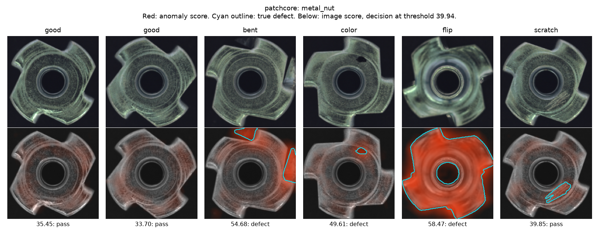
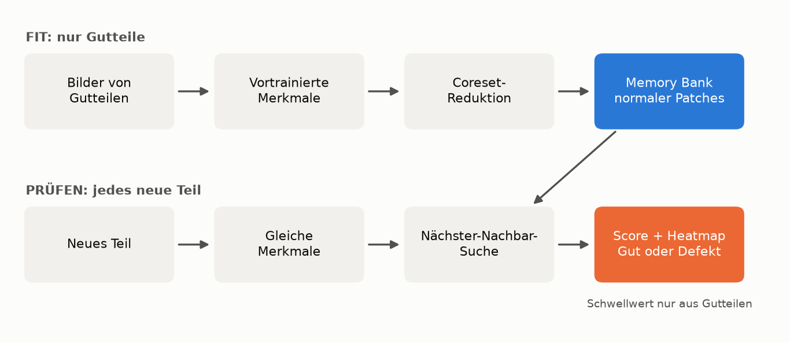
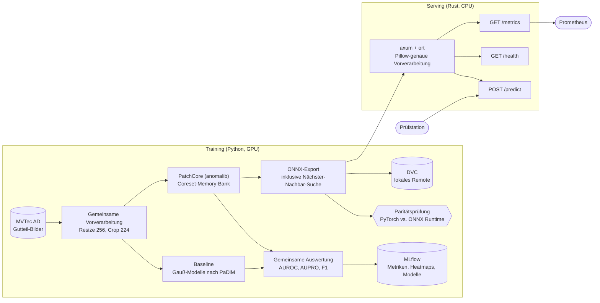
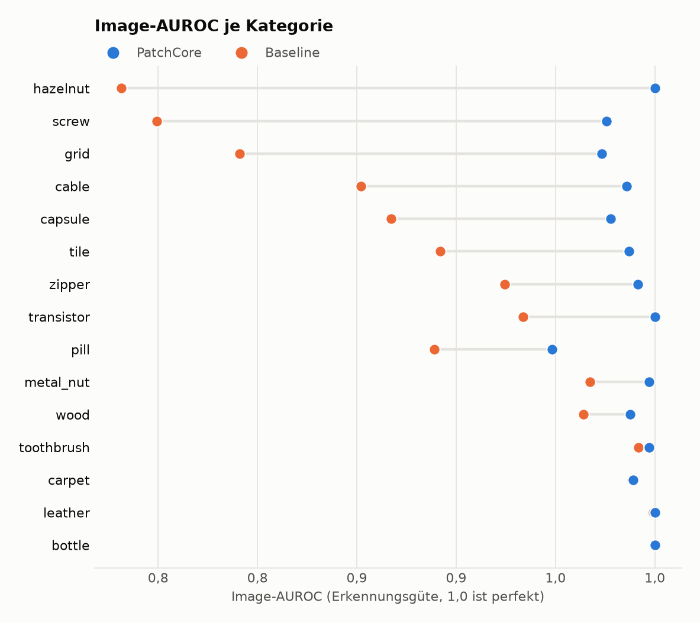
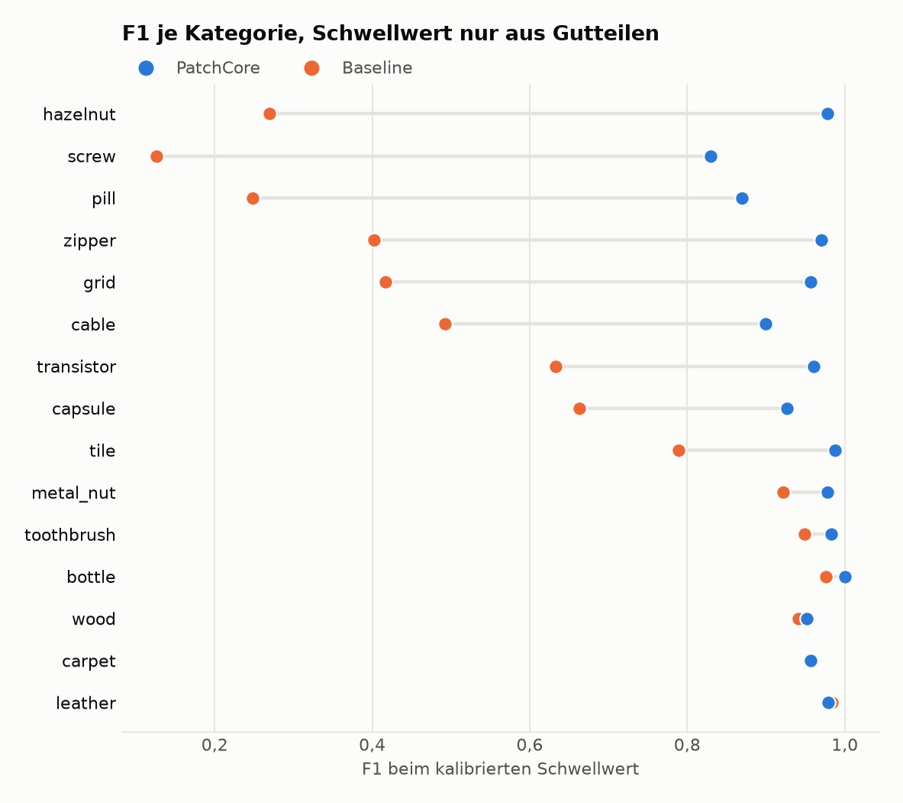
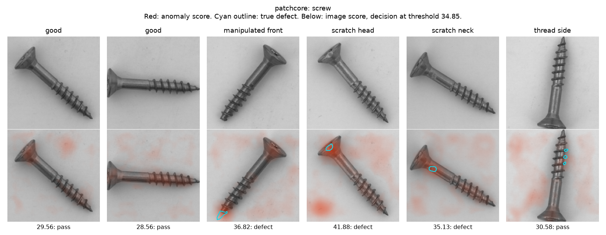
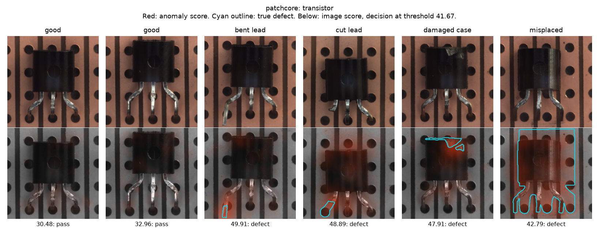
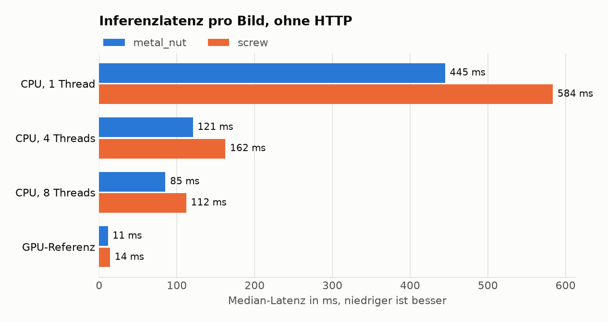

[English](README.md) · **Deutsch**

# Visuelle Qualitätsprüfung mit Anomalieerkennung

### Findet Defekte, die es nie gesehen hat: trainiert nur auf Gutteilen, ausgeliefert von einem Rust-Service auf einer normalen CPU.

      

Eine vollständige industrielle Prüf-Pipeline, vom Rohbild bis zur Inferenz-API mit eingebauten Metriken: eine ehrliche Baseline, das bewährte PatchCore-Verfahren, lückenloses Experiment-Tracking, ein numerisch verifizierter ONNX-Export und ein Rust-Service, dessen Vorverarbeitung **bitgenau** mit Python übereinstimmt.

<!-- generated:highlights:start -->
- **0,987 mittlerer Image-AUROC** über alle 15 Kategorien (Baseline: 0,903)
- **92,5 % der Defekte erkannt** bei 7,1 % Falschausschuss, mit einem Schwellwert ausschließlich aus Gutteilen
- **0,948 F1 ohne Testlabels** (Baseline: 0,651)
- **129 ms Median pro HTTP-Anfrage auf 4 CPU-Threads** (metal_nut), 11 ms als GPU-Referenz ohne HTTP
- **ONNX-Parität:** maximale Score-Abweichung 7,2e-05 gegenüber PyTorch auf echten Testbildern
<!-- generated:highlights:end -->

Jede Zahl auf dieser Seite wird aus einem geloggten MLflow-Lauf oder einer Benchmark-Datei erzeugt. Nichts ist von Hand eingetragen.



*Oben: Testbilder. Unten: Anomalie-Score in Rot, tatsächlicher Defekt in Cyan umrandet. Die Beispiele wählt eine feste Regel ohne Blick auf die Scores aus, es ist also nichts handverlesen: Der Kratzer rechts ist ein echter Fehlschlag, sein Score liegt knapp unter dem Schwellwert. Bilder: MVTec AD, bearbeitet, CC BY-NC-SA 4.0.*

## Warum das zählt

Manuelle Sichtprüfung ist monoton und schwankt in der Qualität. Überwachte Bildverarbeitung braucht viele gelabelte Beispiele jedes Defekts, doch auf einer guten Fertigungslinie sind Defekte selten, und ständig kommen neue Arten hinzu. Dieses System dreht das Problem um: Es lernt, wie *gut* aussieht, und meldet alles andere.

- **Keine Defektbeispiele für den Start nötig.** Ein Produkt lässt sich mit Bildern von Gutteilen einrichten.
- **Erkennt auch das Unerwartete.** Es gibt keine feste Liste von Defektarten, durch die etwas fallen könnte.
- **Zeigt, wo der Fehler sitzt, nicht nur ob.** Heatmaps auf Pixelebene unterstützen schnelle manuelle Prüfung und Ursachenanalyse.
- **Gebaut für weniger Ausschuss und automatisierte Prüfung.** Defekte werden früh erkannt, und Prüfer können sich auf die schwierigen Fälle konzentrieren.

Metall- und pumpenähnliche Teile aus der Stahl- und Pumpenfertigung, zum Beispiel bei Unternehmen wie thyssenkrupp oder Wilo, stehen für die Art von Zielbranche, für die dieser Ansatz relevant ist. Dies ist ein unabhängiges Portfolio-Projekt auf einem öffentlichen Benchmark. Es besteht keine Verbindung zu einem Unternehmen und keine Unterstützung durch ein Unternehmen, und es werden keine Aussagen über Einsparungen in einem realen Werk gemacht.

## So funktioniert es



## Architektur



## Ergebnisse

<!-- generated:summary:start -->
| Mittelwert | Baseline (Fokus 6) | PatchCore (Fokus 6) | Baseline (alle 15) | PatchCore (alle 15) |
| --- | ---: | ---: | ---: | ---: |
| Image-AUROC | 0,921 | 0,985 | 0,903 | 0,987 |
| Pixel-AUROC | 0,964 | 0,981 | 0,959 | 0,976 |
| AUPRO (FPR ≤ 0,3) | 0,899 | 0,933 | 0,871 | 0,909 |
| F1, bester Schwellwert (nutzt Testlabels) | 0,929 | 0,982 | 0,923 | 0,983 |
| F1, kalibrierter Schwellwert | 0,644 | 0,932 | 0,651 | 0,948 |
| Defekt-Recall, kalibriert | 0,573 | 0,898 | 0,567 | 0,925 |
| Falschausschuss-Rate, kalibriert | 0,026 | 0,074 | 0,057 | 0,071 |
<!-- generated:summary:end -->

„Fokus 6“ steht für metal_nut, screw, pill, transistor, bottle und carpet, ausgewählt als die Kategorien, die Metall- und pumpenähnlichen Teilen am nächsten kommen.



**Die Zahl, die auf einer realen Linie zählt:** Der AUROC muss sich nie auf eine Entscheidung festlegen, eine Fertigungslinie schon. Die kalibrierten Zeilen nutzen einen Schwellwert, der aus zurückgehaltenen Gutteil-Bildern stammt und nie aus Testlabels. Genau dort öffnet sich die Lücke:



PatchCore ist nicht in jeder Zeile besser: In den Fokuskategorien verwirft es mehr Gutteile als die Baseline, erkennt dafür aber weit mehr Defekte. Genau über diesen Kompromiss muss eine reale Linie entscheiden, deshalb bleibt er hier sichtbar.

<!-- generated:focus:start -->
| Kategorie | Image-AUROC Baseline | Image-AUROC PatchCore | Pixel-AUROC Baseline | Pixel-AUROC PatchCore | AUPRO Baseline | AUPRO PatchCore |
| --- | ---: | ---: | ---: | ---: | ---: | ---: |
| metal_nut | 0,967 | 0,997 | 0,939 | 0,982 | 0,829 | 0,920 |
| screw | 0,749 | 0,976 | 0,971 | 0,988 | 0,891 | 0,938 |
| pill | 0,889 | 0,948 | 0,942 | 0,976 | 0,909 | 0,933 |
| transistor | 0,934 | 1,000 | 0,971 | 0,969 | 0,906 | 0,944 |
| bottle | 1,000 | 1,000 | 0,977 | 0,981 | 0,912 | 0,927 |
| carpet | 0,988 | 0,989 | 0,985 | 0,988 | 0,948 | 0,937 |
<!-- generated:focus:end -->

Details je Kategorie, MLflow-Run-IDs und alle Heatmaps stehen in [docs/results.md](docs/results.md) (auf Englisch).

### In Aktion





### Warum diese Modelle

- **Baseline: Mahalanobis-Distanz nach PaDiM auf ResNet18-Merkmalen.** Ein Gauß-Modell pro Patch-Position, in geschlossener Form berechnet. Die Wahl fiel gegen einen Convolutional Autoencoder, weil dieser Ansatz deterministisch, schnell und ein anerkannter Referenzpunkt ist. Ein schwacher Autoencoder hätte PatchCore aus dem falschen Grund besser aussehen lassen.
- **PatchCore: das Modell aus anomalib mit WideResNet50-Backbone** und 10 % Coreset. Es vergleicht jeden Patch mit einer Memory Bank aus Gutteil-Patches.

Beide teilen sich einen Loader, einen Vorverarbeitungspfad, eine Nachbearbeitung der Anomaliekarten und ein Metrikmodul, der Vergleich ist also fair. Hyperparameter wurden nicht auf dem Testset abgestimmt.

## Schnell auf einer normalen CPU



<!-- generated:latency:start -->
Intel(R) Core(TM) i5-14400F, 16 logische CPUs, Governor `powersave`, ONNX Runtime 1.31.0, Batchgröße 1, 10 Warm-up-Läufe, 200 Messläufe, oha 1.16.0 mit Concurrency 1. Spitzenspeicher des Servers mit einem geladenen Modell: 763 bis 910 MB. Commit `7e11374f0743`.

| Kategorie | Ebene | Gerät | p50 ms | p95 ms | p99 ms | Bilder/s |
| --- | ---: | ---: | ---: | ---: | ---: | ---: |
| metal_nut | Im Prozess | CPU, 1 Thread | 445,1 | 459,5 | 465,0 | 2,2 |
| metal_nut | Im Prozess | CPU, 4 Threads | 120,7 | 130,7 | 131,5 | 8,2 |
| metal_nut | Im Prozess | CPU, 8 Threads | 85,3 | 86,3 | 87,9 | 11,7 |
| metal_nut | HTTP | CPU, 1 Thread | 452,7 | 464,7 | 470,4 | 2,2 |
| metal_nut | HTTP | CPU, 4 Threads | 129,3 | 137,4 | 138,0 | 7,7 |
| metal_nut | HTTP | CPU, 8 Threads | 91,9 | 92,5 | 95,5 | 10,9 |
| screw | Im Prozess | CPU, 1 Thread | 583,6 | 595,5 | 609,3 | 1,7 |
| screw | Im Prozess | CPU, 4 Threads | 162,5 | 170,7 | 171,3 | 6,2 |
| screw | Im Prozess | CPU, 8 Threads | 112,1 | 113,0 | 117,1 | 8,9 |
| screw | HTTP | CPU, 1 Thread | 594,8 | 608,3 | 627,0 | 1,7 |
| screw | HTTP | CPU, 4 Threads | 171,9 | 184,0 | 189,6 | 5,8 |
| screw | HTTP | CPU, 8 Threads | 124,7 | 128,4 | 135,4 | 8,0 |
| metal_nut | Im Prozess (PyTorch) | GPU | 11,3 | 11,6 | 20,0 | 86,3 |
| screw | Im Prozess (PyTorch) | GPU | 14,1 | 22,6 | 22,9 | 65,0 |
<!-- generated:latency:end -->

Die ONNX-Runtime-Threads wurden mit `taskset` fest zugewiesen: bis 4 Threads ein Hardware-Thread pro Performance-Kern, bei 8 Threads 6 Performance- und 2 Effizienzkerne. Andere Dienste liefen nebenher, die Taktanpassung war aktiv. Die HTTP-Latenz enthält PNG-Dekodierung, Vorverarbeitung und JSON-Kodierung. Die Latenz wächst mit der Größe der Memory Bank, deshalb ist screw langsamer als metal_nut.

## Engineering, das hält

### Das ganze Modell in einer ONNX-Datei

Die Nächster-Nachbar-Suche von PatchCore ist Teil des exportierten Graphen, formuliert als Matrixmultiplikation über die Memory Bank. Ein eigener Wrapper macht das möglich, und die Testsuite erzwingt die Parität auf echten Testbildern:

<!-- generated:parity:start -->
| Kategorie | Opset | MB | Memory Bank | Bilder | Max. Score-Fehler | Max. Map-Fehler |
| --- | ---: | ---: | ---: | ---: | ---: | ---: |
| metal_nut | 18 | 195 | 15523 | 20 | 6,5e-05 | 2,3e-04 |
| screw | 18 | 238 | 22579 | 20 | 6,9e-05 | 1,5e-04 |
| pill | 18 | 215 | 18816 | 20 | 7,2e-05 | 2,7e-04 |
| transistor | 18 | 192 | 15052 | 20 | 7,2e-05 | 1,5e-04 |
| bottle | 18 | 190 | 14739 | 20 | 5,0e-05 | 2,1e-04 |
| carpet | 18 | 221 | 19756 | 20 | 5,3e-05 | 1,0e-04 |
<!-- generated:parity:end -->

### Bitgenaue Vorverarbeitung über Sprachgrenzen hinweg

Wandert die Vorverarbeitung in eine andere Sprache, kann sich still ändern, was das Modell sieht. Hier kann das nicht unbemerkt passieren: Der Rust-Service portiert den Festkomma-Resize von Pillow, und `tests/test_serving.py` verlangt, dass die Tensoren auf Bildern aus allen 15 Kategorien **bitgenau** denen aus Python entsprechen. Das ist für PNG verifiziert. JPEG-Decoder unterscheiden sich je nach Bibliothek, JPEG-Uploads fallen also nicht unter diese Garantie.

### Reproduzierbar bis zum letzten Tensor

Feste Seeds, eine festgeschriebene Umgebung und ein Git-Commit an jedem Lauf. Zwei vollständige Durchläufe aus verschiedenen Commits lieferten identische Metriken, und `scripts/check_determinism.py` bestätigt, dass ein erneutes Fitten einer Kategorie ihre Tensoren exakt reproduziert.

### DevOps und MLOps

| Bereich | Was vorhanden ist |
|---|---|
| Umgebung | `uv` mit Lockfile, PyTorch aus dem CUDA-12.8-Index, GPU mit echter Berechnung geprüft |
| Automatisierung | Ein `Makefile` vom Setup bis zum Report |
| Codequalität | `ruff`, `mypy`, `pytest`, `clippy`, `rustfmt` und lokale Pre-Commit-Hooks, die Datensatz- und Modelldateien blockieren |
| Experiment-Tracking | MLflow per Docker Compose: Parameter, Metriken je Kategorie, Heatmaps, Modelle, Git-Commit, Umgebung |
| Daten- und Modellversionierung | DVC mit lokalem Remote, nur Pointer in Git |
| Container | Multi-Stage-Build, Distroless-Laufzeit-Image, Nicht-Root-Benutzer, schreibgeschütztes Dateisystem, alle Capabilities entzogen, Healthcheck |
| Observability | Prometheus-`/metrics` mit Entscheidungs- und Fehlerzählern sowie Latenz-Histogrammen je Verarbeitungsschritt |
| Reporting | `make report` schreibt Ergebnisdokument, Diagramme und README-Tabellen aus geloggten Läufen |

CI/CD ist noch nicht enthalten, und es ist kein Prometheus-Server oder Grafana-Dashboard eingerichtet, das die Metriken abruft. Die gesamte Pipeline läuft lokal.

## Grenzen

- **MVTec AD ist ein Benchmark, keine Fertigungslinie.** Die Bilder sind sauber, zentriert und gleichmäßig beleuchtet, die Ergebnisse lassen also keinen Schluss auf die Leistung an einer realen Station zu.
- **Domain Shift.** Neue Beleuchtung, Kameraposition, Materialchargen oder Verschleiß können Fehlalarme auslösen. Modelle müssen bei veränderten Bedingungen neu gefittet und überwacht werden.
- **Die Schwellwert-Kalibrierung ist empfindlich.** In kleinen Kategorien stützt sie sich auf sehr wenige Bilder (6 bei toothbrush), und ein Defekt kann knapp unter dem Schwellwert landen. Außerdem werden Gutteil-Bilder vom Fitten zurückgehalten, die Zahlen können also leicht von veröffentlichten PatchCore-Ergebnissen abweichen.
- **Der Center Crop schneidet den Bildrand ab.** Defekte ganz am Rand können nicht erkannt werden und werden auch nicht gezählt.
- **Ein Seed, Modelle je Kategorie.** Die Zahlen stammen aus einem Seed, und jedes Produkt braucht sein eigenes Modell mit eigener Memory Bank.
- **Durchsatz.** Jedes Modell bearbeitet eine Anfrage nach der anderen, begrenzt durch die CPU bei dieser Größe der Memory Bank.

## Der Weg ins reale Werk

1. **Kamera und Beleuchtung:** feste Montage, kontrolliertes Licht und eine Auflösung passend zum kleinsten relevanten Defekt.
2. **Datenerhebung:** Gutteile über Schichten, Chargen und Werkzeugverschleiß hinweg, geprüft durch die Qualitätssicherung.
3. **Schwellwert je Produkt:** auf einer großen Menge von Gutteilen kalibrieren, mit echten Defekten validieren und einen übersehenen Defekt gegen einen Falschausschuss abwägen.
4. **Human-in-the-Loop:** Grenzfälle mit Heatmap an Prüfer weiterleiten und deren Entscheidungen zurückführen.
5. **Drift-Monitoring:** bei Verschiebungen der Score-Verteilung und der Falschausschuss-Rate alarmieren, mit einem festgelegten Prozess zum Neu-Fitten.
6. **Integration:** Anbindung an Liniensteuerung und MES, Modellversionen je Produkt und die Möglichkeit zum Rollback.
7. **Geschwindigkeit:** kleinere Coresets, einen approximativen Nächster-Nachbar-Index oder eine kleine GPU gegen die Taktzeit der Linie bewerten.

## Selbst reproduzieren

Voraussetzungen: Linux, eine NVIDIA-GPU mit Unterstützung für CUDA 12.8+, [uv](https://docs.astral.sh/uv/), Docker mit Compose und Rust.

1. MVTec AD von <https://www.mvtec.com/company/research/datasets/mvtec-ad> herunterladen, nachdem die Lizenz akzeptiert wurde, und so entpacken, dass `data/mvtec_ad/bottle/train/good/000.png` existiert.
2. Die Pipeline starten:

```bash
make setup && make data-check && make train && make eval && make export && make bench && make report
```

MLflow startet automatisch unter <http://127.0.0.1:5000>. So lässt sich der Service ausprobieren:

```bash
make serve   # 127.0.0.1:8090, änderbar mit INFERENCE_PORT
curl -F image=@data/mvtec_ad/metal_nut/test/scratch/000.png \
  'http://127.0.0.1:8090/predict?category=metal_nut&heatmap=true'
```

`make test` und `make lint` führen die Prüfungen aus. Die CPU-Zuweisung des Benchmarks in `scripts/bench.py` ist auf einen i5-14400F zugeschnitten und muss auf anderen Rechnern angepasst werden.

```text
src/anomaly_inspect/   Daten, Modelle, Metriken, Pipeline, ONNX-Export, Diagramme, Reports
configs/               baseline.yaml, patchcore.yaml
scripts/               check_data, train, evaluate, export_onnx, bench, generate_report
serving/               Rust-Service, Multi-Stage-Dockerfile
tests/                 Unit-Tests und sprachübergreifende Paritätstests
results/, docs/        Benchmark-Ausgaben, erzeugte Ergebnisse und Abbildungen
```

## Daten und Lizenz

Dieses Projekt nutzt den **MVTec Anomaly Detection Datensatz (MVTec AD)** unter der Lizenz [CC BY-NC-SA 4.0](https://creativecommons.org/licenses/by-nc-sa/4.0/deed.de), die **ausschließlich nicht-kommerzielle Nutzung** erlaubt. Der Datensatz ist nicht Teil dieses Repositorys und muss bei MVTec heruntergeladen werden. Die Heatmap-Abbildungen enthalten bearbeitete Auszüge und stehen unter derselben Lizenz, siehe [den Hinweis](docs/figures/NOTICE.md).

Der Code in diesem Repository steht unter keiner Open-Source-Lizenz. Alle Rechte vorbehalten.

Bitte zitieren:

> Paul Bergmann, Michael Fauser, David Sattlegger, Carsten Steger. *MVTec AD: A Comprehensive Real-World Dataset for Unsupervised Anomaly Detection.* IEEE/CVF CVPR, 2019.

> Paul Bergmann, Kilian Batzner, Michael Fauser, David Sattlegger, Carsten Steger. *The MVTec Anomaly Detection Dataset: A Comprehensive Real-World Dataset for Unsupervised Anomaly Detection.* International Journal of Computer Vision, 2021.

Methoden: Defard et al., *PaDiM*, ICPR Workshops 2021. Roth et al., *Towards Total Recall in Industrial Anomaly Detection*, CVPR 2022. PatchCore-Implementierung: [anomalib](https://github.com/open-edge-platform/anomalib).
