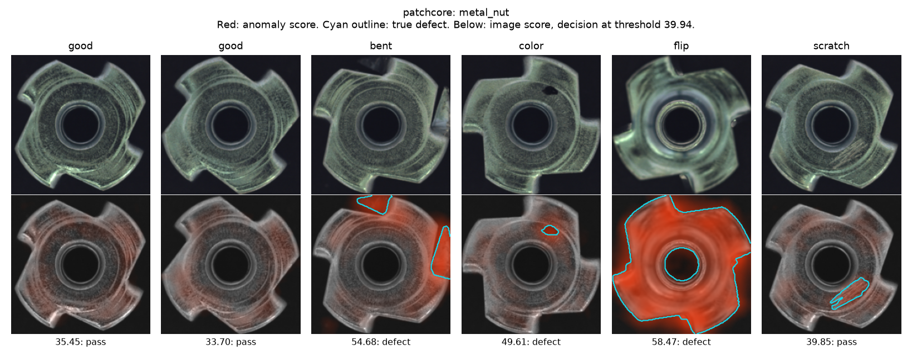
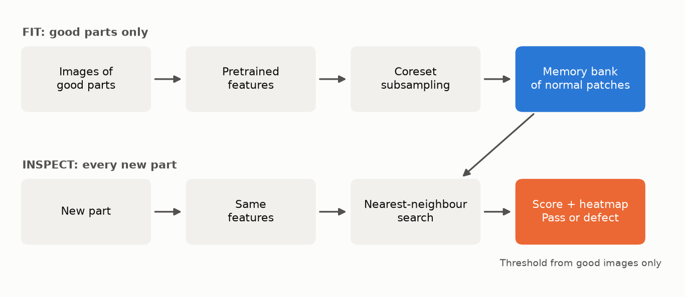
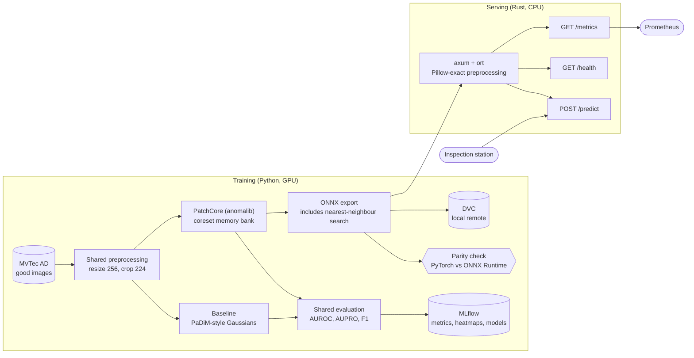
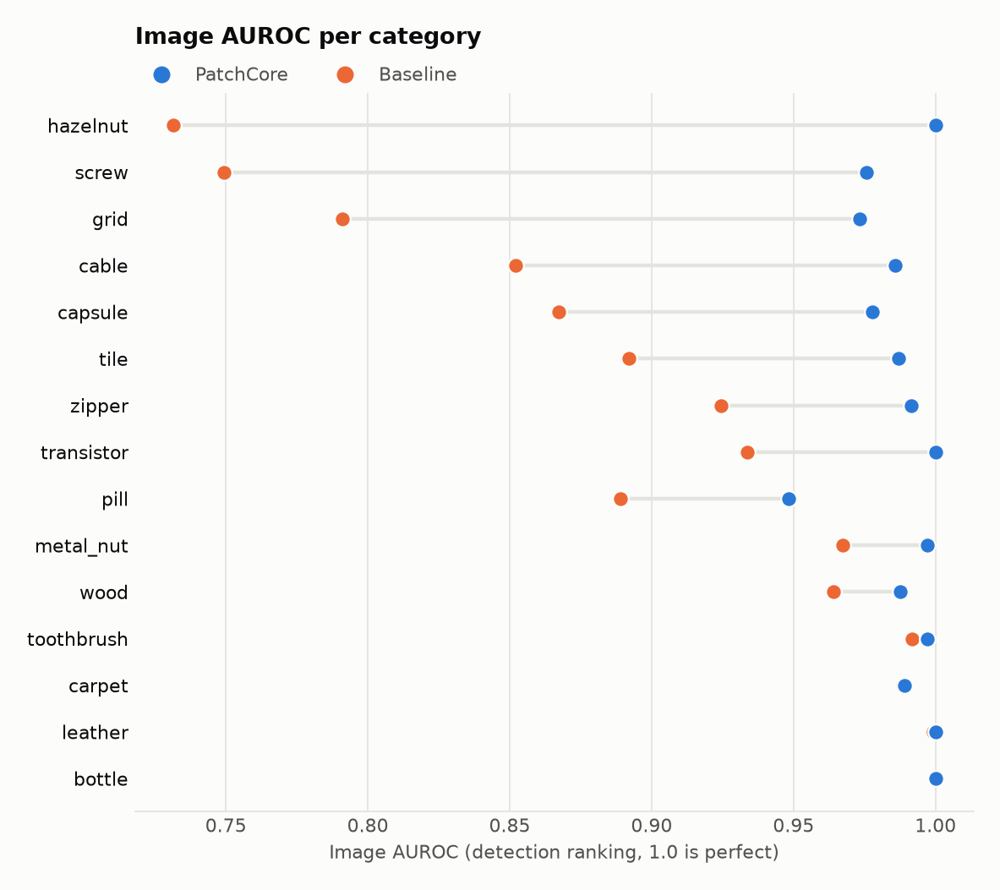
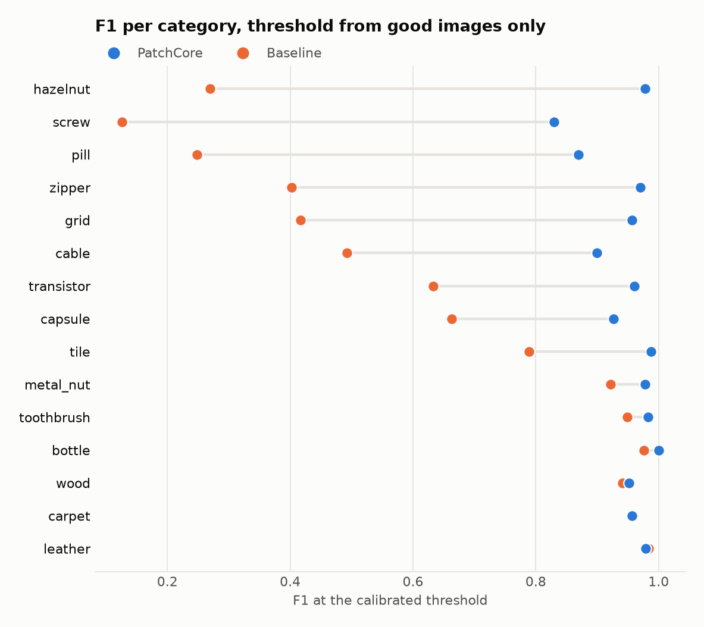
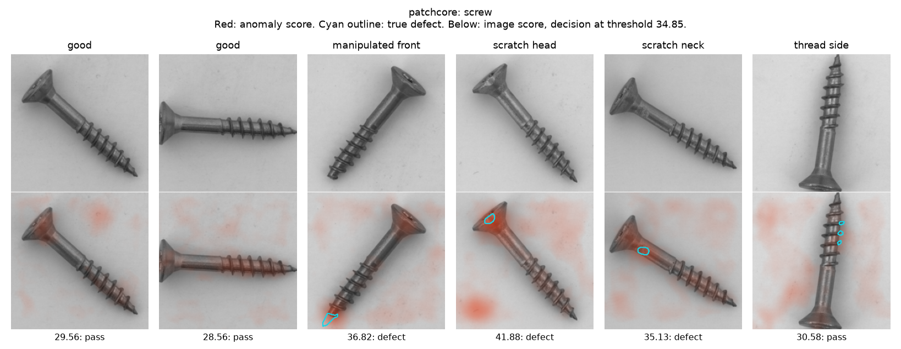
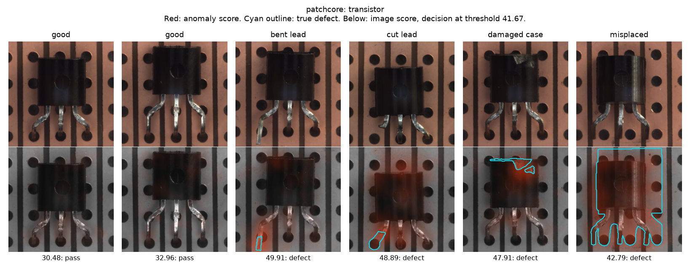
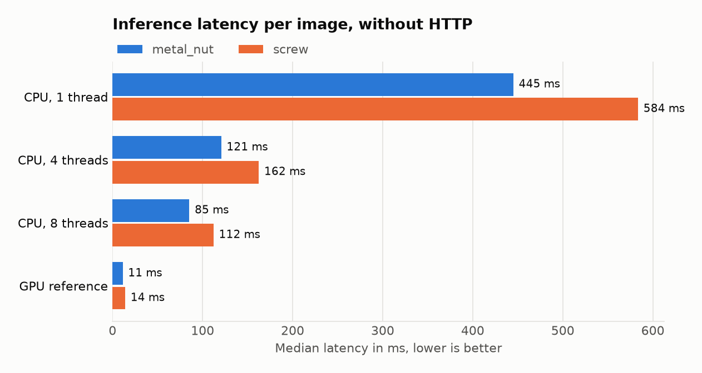

**English** · [Deutsch](README.de.md)

# Visual Quality Inspection with Anomaly Detection

### Finds defects it has never seen, trained only on good parts, served from a Rust service on a plain CPU.

      

A complete industrial inspection pipeline, from raw images to an inference API with built-in metrics: an honest baseline, the proven PatchCore method, full experiment tracking, a numerically verified ONNX export, and a Rust service whose preprocessing matches Python **bit for bit**.

<!-- generated:highlights:start -->
- **0.987 mean image AUROC** across all 15 categories (baseline: 0.903)
- **92.5% of defects caught** at a 7.1% false reject rate, with a threshold set from good images alone
- **0.948 F1 without touching test labels** (baseline: 0.651)
- **129 ms median per HTTP request on 4 CPU threads** (metal_nut), with 11 ms as the GPU reference without HTTP
- **ONNX parity:** maximum score difference of 7.2e-05 from PyTorch on real test images
<!-- generated:highlights:end -->

Every number on this page is generated from a logged MLflow run or a benchmark file. Nothing is typed by hand.



*Top: test images. Bottom: anomaly score in red, true defect outlined in cyan. Examples are picked by a fixed rule that ignores scores, so nothing is cherry-picked: the scratch on the right is a real miss, scoring just under the threshold. Images: MVTec AD, adapted, CC BY-NC-SA 4.0.*

## Why this matters

Manual inspection is repetitive and inconsistent. Supervised vision needs many labelled examples of every defect, yet on a good production line defects are rare and new kinds keep appearing. This system flips the problem: it learns what *good* looks like and flags everything else.

- **No defect samples needed to start.** Set up a product from images of good parts.
- **Catches the unexpected.** There is no fixed list of defect types to fall out of.
- **Shows where, not just whether.** Pixel-level heatmaps support fast human review and root-cause work.
- **Built for scrap reduction and inspection automation.** Catch defects early, and let inspectors focus on the hard cases.

Metal and pump-like parts in steel and pump manufacturing, for example at companies such as thyssenkrupp or Wilo, are the kind of target industry this approach is relevant to. This is an independent portfolio project on a public benchmark. It is not affiliated with or endorsed by any company, and it makes no claim about savings at any real plant.

## How it works



## Architecture



## Results

<!-- generated:summary:start -->
| Mean | Baseline (focus 6) | PatchCore (focus 6) | Baseline (all 15) | PatchCore (all 15) |
| --- | ---: | ---: | ---: | ---: |
| Image AUROC | 0.921 | 0.985 | 0.903 | 0.987 |
| Pixel AUROC | 0.964 | 0.981 | 0.959 | 0.976 |
| AUPRO (FPR ≤ 0.3) | 0.899 | 0.933 | 0.871 | 0.909 |
| F1, best threshold (uses test labels) | 0.929 | 0.982 | 0.923 | 0.983 |
| F1, calibrated threshold | 0.644 | 0.932 | 0.651 | 0.948 |
| Defect recall, calibrated | 0.573 | 0.898 | 0.567 | 0.925 |
| False reject rate, calibrated | 0.026 | 0.074 | 0.057 | 0.071 |
<!-- generated:summary:end -->

"Focus 6" means metal_nut, screw, pill, transistor, bottle and carpet, chosen as the closest to metal and pump-like parts.



**The number that counts on a real line:** AUROC never has to commit to a decision, but a production line does. The calibrated rows use a threshold set from held-out good images, never from test labels. That is where the gap opens up:



PatchCore isn't better on every row: it rejects more good parts than the baseline in the focus categories, while catching far more defects. That trade-off is exactly what a real line has to decide on, so it stays visible here.

<!-- generated:focus:start -->
| Category | Image AUROC Baseline | Image AUROC PatchCore | Pixel AUROC Baseline | Pixel AUROC PatchCore | AUPRO Baseline | AUPRO PatchCore |
| --- | ---: | ---: | ---: | ---: | ---: | ---: |
| metal_nut | 0.967 | 0.997 | 0.939 | 0.982 | 0.829 | 0.920 |
| screw | 0.749 | 0.976 | 0.971 | 0.988 | 0.891 | 0.938 |
| pill | 0.889 | 0.948 | 0.942 | 0.976 | 0.909 | 0.933 |
| transistor | 0.934 | 1.000 | 0.971 | 0.969 | 0.906 | 0.944 |
| bottle | 1.000 | 1.000 | 0.977 | 0.981 | 0.912 | 0.927 |
| carpet | 0.988 | 0.989 | 0.985 | 0.988 | 0.948 | 0.937 |
<!-- generated:focus:end -->

Per-category details, MLflow run IDs and all heatmaps are in [docs/results.md](docs/results.md).

### See it work





### Why these models

- **Baseline: PaDiM-style Mahalanobis distance on ResNet18 features.** One Gaussian per patch location, fitted in closed form. It was chosen over a convolutional autoencoder because it is deterministic, fast and a recognised reference point. A weak autoencoder would have made PatchCore look better for the wrong reason.
- **PatchCore: anomalib's model with a WideResNet50 backbone** and a 10% coreset. It compares each patch with a memory bank of good patches.

Both share one loader, one preprocessing path, one anomaly map post-processing and one metrics module, so the comparison is fair. Hyperparameters were not tuned on the test set.

## Fast on a plain CPU



<!-- generated:latency:start -->
Intel(R) Core(TM) i5-14400F, 16 logical CPUs, governor `powersave`, ONNX Runtime 1.31.0, batch size 1, 10 warm-up runs, 200 measured runs, oha 1.16.0 at concurrency 1. Peak server memory with one model loaded: 763 to 910 MB. Commit `7e11374f0743`.

| Category | Level | Device | p50 ms | p95 ms | p99 ms | Images/s |
| --- | ---: | ---: | ---: | ---: | ---: | ---: |
| metal_nut | In process | CPU, 1 thread | 445.1 | 459.5 | 465.0 | 2.2 |
| metal_nut | In process | CPU, 4 threads | 120.7 | 130.7 | 131.5 | 8.2 |
| metal_nut | In process | CPU, 8 threads | 85.3 | 86.3 | 87.9 | 11.7 |
| metal_nut | HTTP | CPU, 1 thread | 452.7 | 464.7 | 470.4 | 2.2 |
| metal_nut | HTTP | CPU, 4 threads | 129.3 | 137.4 | 138.0 | 7.7 |
| metal_nut | HTTP | CPU, 8 threads | 91.9 | 92.5 | 95.5 | 10.9 |
| screw | In process | CPU, 1 thread | 583.6 | 595.5 | 609.3 | 1.7 |
| screw | In process | CPU, 4 threads | 162.5 | 170.7 | 171.3 | 6.2 |
| screw | In process | CPU, 8 threads | 112.1 | 113.0 | 117.1 | 8.9 |
| screw | HTTP | CPU, 1 thread | 594.8 | 608.3 | 627.0 | 1.7 |
| screw | HTTP | CPU, 4 threads | 171.9 | 184.0 | 189.6 | 5.8 |
| screw | HTTP | CPU, 8 threads | 124.7 | 128.4 | 135.4 | 8.0 |
| metal_nut | In process (PyTorch) | GPU | 11.3 | 11.6 | 20.0 | 86.3 |
| screw | In process (PyTorch) | GPU | 14.1 | 22.6 | 22.9 | 65.0 |
<!-- generated:latency:end -->

ONNX Runtime threads were pinned with `taskset`: one hardware thread per performance core up to 4 threads, and 6 performance plus 2 efficiency cores at 8 threads. Other services were running, with frequency scaling on. HTTP latency includes PNG decoding, preprocessing and JSON encoding. Latency grows with memory bank size, which is why screw is slower than metal_nut.

## Engineering that holds up

### The whole model in one ONNX file

PatchCore's nearest-neighbour search is part of the exported graph, written as matrix multiplication over the memory bank. A custom wrapper makes this possible, and parity is enforced by the test suite on real test images:

<!-- generated:parity:start -->
| Category | Opset | MB | Memory bank | Images | Max score error | Max map error |
| --- | ---: | ---: | ---: | ---: | ---: | ---: |
| metal_nut | 18 | 195 | 15523 | 20 | 6.5e-05 | 2.3e-04 |
| screw | 18 | 238 | 22579 | 20 | 6.9e-05 | 1.5e-04 |
| pill | 18 | 215 | 18816 | 20 | 7.2e-05 | 2.7e-04 |
| transistor | 18 | 192 | 15052 | 20 | 7.2e-05 | 1.5e-04 |
| bottle | 18 | 190 | 14739 | 20 | 5.0e-05 | 2.1e-04 |
| carpet | 18 | 221 | 19756 | 20 | 5.3e-05 | 1.0e-04 |
<!-- generated:parity:end -->

### Bit-identical preprocessing across languages

Moving preprocessing to another language can quietly change what the model sees. Here, that can't happen unnoticed: the Rust service ports Pillow's fixed-point resize, and `tests/test_serving.py` requires the resulting tensors to be **bit-identical** to Python's on images from all 15 categories. This is verified for PNG. JPEG decoders differ between libraries, so JPEG uploads aren't covered by that guarantee.

### Reproducible to the last tensor

Fixed seeds, a locked environment and a git commit on every run. Two full sweeps from different commits produced identical metrics, and `scripts/check_determinism.py` confirms that refitting a category reproduces its fitted tensors exactly.

### DevOps and MLOps

| Area | What's in place |
|---|---|
| Environment | `uv` with a lockfile, PyTorch from the CUDA 12.8 index, GPU verified with a real computation |
| Automation | One `Makefile` from setup to report |
| Code quality | `ruff`, `mypy`, `pytest`, `clippy`, `rustfmt`, and local pre-commit hooks that block dataset and model files |
| Experiment tracking | MLflow via Docker Compose: parameters, per-category metrics, heatmaps, models, git commit, environment |
| Data and model versioning | DVC with a local remote, with only pointers in git |
| Containers | Multi-stage build, distroless runtime image, non-root user, read-only filesystem, all capabilities dropped, health check |
| Observability | Prometheus `/metrics` with decision counts, error counts and per-stage latency histograms |
| Reporting | `make report` writes the results document, charts and README tables from logged runs |

CI/CD isn't included yet, and no Prometheus server or Grafana dashboard is set up to consume the metrics. The whole pipeline runs locally.

## Limitations

- **MVTec AD is a benchmark, not a production line.** Images are clean, centred and evenly lit, so results here don't predict performance at a real station.
- **Domain shift.** New lighting, camera position, material batches or wear can raise false alarms. Models need refitting and monitoring when conditions change.
- **Threshold calibration is fragile.** It uses very few images in small categories (6 for toothbrush), and a defect can land just under the threshold. Good images are also held out from fitting, so numbers can differ slightly from published PatchCore results.
- **The centre crop discards the image border.** Defects at the very edge can't be detected and aren't counted either.
- **Single seed, per-category models.** Numbers come from one seed, and each product needs its own model and memory bank.
- **Throughput.** Each model handles one request at a time, limited by the CPU at this memory bank size.

## From here to a real plant

1. **Camera and lighting:** fixed mounting, controlled light, and resolution matched to the smallest relevant defect.
2. **Data collection:** good parts across shifts, batches and tool wear, reviewed by quality staff.
3. **Threshold per product:** calibrate on a large good set, validate with real defects, and weigh a missed defect against a false reject.
4. **Human-in-the-loop review:** route borderline parts to inspectors with the heatmap, and feed the decisions back.
5. **Drift monitoring:** alert on shifts in score distribution and false reject rate, with a defined refit process.
6. **Integration:** connect to line control and MES systems, version models per product, and support rollback.
7. **Speed:** evaluate smaller coresets, an approximate nearest-neighbour index, or a small GPU against the line's cycle time.

## Reproduce it

Requirements: Linux, an NVIDIA GPU with CUDA 12.8+ support, [uv](https://docs.astral.sh/uv/), Docker with Compose, and Rust.

1. Download MVTec AD from <https://www.mvtec.com/company/research/datasets/mvtec-ad> after accepting its license, and extract it so that `data/mvtec_ad/bottle/train/good/000.png` exists.
2. Run the pipeline:

```bash
make setup && make data-check && make train && make eval && make export && make bench && make report
```

MLflow starts automatically at <http://127.0.0.1:5000>. To try the service:

```bash
make serve   # 127.0.0.1:8090, change it with INFERENCE_PORT
curl -F image=@data/mvtec_ad/metal_nut/test/scratch/000.png \
  'http://127.0.0.1:8090/predict?category=metal_nut&heatmap=true'
```

`make test` and `make lint` run the checks. The benchmark's CPU pinning in `scripts/bench.py` is specific to an i5-14400F, so adjust it on other machines.

```text
src/anomaly_inspect/   data, models, metrics, pipeline, ONNX export, charts, report generation
configs/               baseline.yaml, patchcore.yaml
scripts/               check_data, train, evaluate, export_onnx, bench, generate_report
serving/               Rust service, multi-stage Dockerfile
tests/                 unit tests and cross-language parity tests
results/, docs/        benchmark output, generated results and figures
```

## Data and license

This project uses the **MVTec Anomaly Detection dataset (MVTec AD)**, licensed under [CC BY-NC-SA 4.0](https://creativecommons.org/licenses/by-nc-sa/4.0/), which permits **non-commercial use only**. The dataset isn't part of this repository and must be downloaded from MVTec. The heatmap figures contain adapted excerpts and are shared under the same license, see [the notice](docs/figures/NOTICE.md).

The code in this repository has no open-source license. All rights are reserved.

Please cite:

> Paul Bergmann, Michael Fauser, David Sattlegger, Carsten Steger. *MVTec AD: A Comprehensive Real-World Dataset for Unsupervised Anomaly Detection.* IEEE/CVF CVPR, 2019.

> Paul Bergmann, Kilian Batzner, Michael Fauser, David Sattlegger, Carsten Steger. *The MVTec Anomaly Detection Dataset: A Comprehensive Real-World Dataset for Unsupervised Anomaly Detection.* International Journal of Computer Vision, 2021.

Methods: Defard et al., *PaDiM*, ICPR Workshops 2021. Roth et al., *Towards Total Recall in Industrial Anomaly Detection*, CVPR 2022. PatchCore implementation: [anomalib](https://github.com/open-edge-platform/anomalib).
