# Results

Generated by `make report`. Do not edit by hand.

## Provenance

| Family | MLflow summary run | Git commit | Seed |
| --- | --- | --- | ---: |
| Baseline | `972f8122b7bc486aa9fa04071e6e115c` | `7e11374f0743` | 42 |
| PatchCore | `e488a361f30c4d84afed2cbf9ce7801a` | `7e11374f0743` | 42 |

## Summary

| Mean | Baseline (focus 6) | PatchCore (focus 6) | Baseline (all 15) | PatchCore (all 15) |
| --- | ---: | ---: | ---: | ---: |
| Image AUROC | 0.921 | 0.985 | 0.903 | 0.987 |
| Pixel AUROC | 0.964 | 0.981 | 0.959 | 0.976 |
| AUPRO (FPR ≤ 0.3) | 0.899 | 0.933 | 0.871 | 0.909 |
| F1, best threshold (uses test labels) | 0.929 | 0.982 | 0.923 | 0.983 |
| F1, calibrated threshold | 0.644 | 0.932 | 0.651 | 0.948 |
| Defect recall, calibrated | 0.573 | 0.898 | 0.567 | 0.925 |
| False reject rate, calibrated | 0.026 | 0.074 | 0.057 | 0.071 |

"Focus 6" means metal_nut, screw, pill, transistor, bottle, carpet.

## Detection and localisation per category

| Category | Image AUROC baseline | Image AUROC PatchCore | Pixel AUROC baseline | Pixel AUROC PatchCore | AUPRO baseline | AUPRO PatchCore |
| --- | ---: | ---: | ---: | ---: | ---: | ---: |
| metal_nut | 0.967 | 0.997 | 0.939 | 0.982 | 0.829 | 0.920 |
| screw | 0.749 | 0.976 | 0.971 | 0.988 | 0.891 | 0.938 |
| pill | 0.889 | 0.948 | 0.942 | 0.976 | 0.909 | 0.933 |
| transistor | 0.934 | 1.000 | 0.971 | 0.969 | 0.906 | 0.944 |
| bottle | 1.000 | 1.000 | 0.977 | 0.981 | 0.912 | 0.927 |
| carpet | 0.988 | 0.989 | 0.985 | 0.988 | 0.948 | 0.937 |

All categories:

| Category | Image AUROC baseline | Image AUROC PatchCore | Pixel AUROC baseline | Pixel AUROC PatchCore | AUPRO baseline | AUPRO PatchCore |
| --- | ---: | ---: | ---: | ---: | ---: | ---: |
| bottle | 1.000 | 1.000 | 0.977 | 0.981 | 0.912 | 0.927 |
| cable | 0.852 | 0.986 | 0.946 | 0.980 | 0.803 | 0.908 |
| capsule | 0.867 | 0.978 | 0.977 | 0.987 | 0.887 | 0.913 |
| carpet | 0.988 | 0.989 | 0.985 | 0.988 | 0.948 | 0.937 |
| grid | 0.791 | 0.973 | 0.947 | 0.977 | 0.830 | 0.903 |
| hazelnut | 0.731 | 1.000 | 0.964 | 0.984 | 0.823 | 0.932 |
| leather | 0.999 | 1.000 | 0.990 | 0.990 | 0.971 | 0.966 |
| metal_nut | 0.967 | 0.997 | 0.939 | 0.982 | 0.829 | 0.920 |
| pill | 0.889 | 0.948 | 0.942 | 0.976 | 0.909 | 0.933 |
| screw | 0.749 | 0.976 | 0.971 | 0.988 | 0.891 | 0.938 |
| tile | 0.892 | 0.987 | 0.885 | 0.948 | 0.686 | 0.793 |
| toothbrush | 0.992 | 0.997 | 0.986 | 0.986 | 0.894 | 0.855 |
| transistor | 0.934 | 1.000 | 0.971 | 0.969 | 0.906 | 0.944 |
| wood | 0.964 | 0.988 | 0.928 | 0.929 | 0.868 | 0.846 |
| zipper | 0.924 | 0.992 | 0.970 | 0.979 | 0.906 | 0.918 |

## Decisions per category

"F1 max" chooses the best threshold using test labels, which is impossible in production. The other
columns use a threshold calibrated on held-out good training images only (mean + 3 standard
deviations of their scores).

| Category | F1 max baseline | F1 max PatchCore | F1 calibrated baseline | F1 calibrated PatchCore | Recall baseline | Recall PatchCore | False rejects baseline | False rejects PatchCore |
| --- | ---: | ---: | ---: | ---: | ---: | ---: | ---: | ---: |
| bottle | 1.000 | 1.000 | 0.976 | 1.000 | 0.952 | 1.000 | 0.000 | 0.000 |
| cable | 0.851 | 0.973 | 0.492 | 0.899 | 0.337 | 0.826 | 0.052 | 0.017 |
| capsule | 0.940 | 0.977 | 0.663 | 0.927 | 0.505 | 0.872 | 0.087 | 0.043 |
| carpet | 0.978 | 0.989 | 0.959 | 0.957 | 0.921 | 0.989 | 0.000 | 0.250 |
| grid | 0.857 | 0.957 | 0.417 | 0.957 | 0.263 | 0.965 | 0.000 | 0.143 |
| hazelnut | 0.859 | 1.000 | 0.270 | 0.978 | 0.171 | 0.957 | 0.175 | 0.000 |
| leather | 0.995 | 1.000 | 0.984 | 0.979 | 1.000 | 1.000 | 0.094 | 0.125 |
| metal_nut | 0.969 | 0.989 | 0.921 | 0.978 | 0.882 | 0.978 | 0.136 | 0.091 |
| pill | 0.938 | 0.954 | 0.248 | 0.870 | 0.142 | 0.780 | 0.000 | 0.077 |
| screw | 0.868 | 0.963 | 0.126 | 0.829 | 0.067 | 0.714 | 0.000 | 0.024 |
| tile | 0.897 | 0.988 | 0.789 | 0.988 | 0.667 | 0.976 | 0.061 | 0.000 |
| toothbrush | 0.968 | 0.984 | 0.949 | 0.983 | 0.933 | 0.967 | 0.083 | 0.000 |
| transistor | 0.822 | 1.000 | 0.633 | 0.961 | 0.475 | 0.925 | 0.017 | 0.000 |
| wood | 0.952 | 0.974 | 0.941 | 0.952 | 0.933 | 0.983 | 0.158 | 0.263 |
| zipper | 0.947 | 0.992 | 0.403 | 0.970 | 0.252 | 0.950 | 0.000 | 0.031 |

## Latency

Intel(R) Core(TM) i5-14400F, 16 logical CPUs, governor `powersave`, ONNX Runtime 1.31.0, batch size 1, 10 warm-up runs, 200 measured runs, oha 1.16.0 at concurrency 1. Peak server memory with one model loaded: 763 to 910 MB. Commit `7e11374f0743`.

| Category | Level | Device | p50 ms | p95 ms | p99 ms | Images/s |
| --- | ---: | ---: | ---: | ---: | ---: | ---: |
| metal_nut | In process | CPU, 1 thread | 445.1 | 459.5 | 465.0 | 2.2 |
| metal_nut | In process | CPU, 4 threads | 120.7 | 130.7 | 131.5 | 8.2 |
| metal_nut | In process | CPU, 8 threads | 85.3 | 86.3 | 87.9 | 11.7 |
| metal_nut | HTTP | CPU, 1 thread | 452.7 | 464.7 | 470.4 | 2.2 |
| metal_nut | HTTP | CPU, 4 threads | 129.3 | 137.4 | 138.0 | 7.7 |
| metal_nut | HTTP | CPU, 8 threads | 91.9 | 92.5 | 95.5 | 10.9 |
| screw | In process | CPU, 1 thread | 583.6 | 595.5 | 609.3 | 1.7 |
| screw | In process | CPU, 4 threads | 162.5 | 170.7 | 171.3 | 6.2 |
| screw | In process | CPU, 8 threads | 112.1 | 113.0 | 117.1 | 8.9 |
| screw | HTTP | CPU, 1 thread | 594.8 | 608.3 | 627.0 | 1.7 |
| screw | HTTP | CPU, 4 threads | 171.9 | 184.0 | 189.6 | 5.8 |
| screw | HTTP | CPU, 8 threads | 124.7 | 128.4 | 135.4 | 8.0 |
| metal_nut | In process (PyTorch) | GPU | 11.3 | 11.6 | 20.0 | 86.3 |
| screw | In process (PyTorch) | GPU | 14.1 | 22.6 | 22.9 | 65.0 |

## ONNX parity

Maximum absolute difference between PyTorch and ONNX Runtime on real test images. Tolerances:
0.001 for scores, 0.01 for anomaly map pixels. Scores are
in the tens.

| Category | Opset | MB | Memory bank | Images | Max score error | Max map error |
| --- | ---: | ---: | ---: | ---: | ---: | ---: |
| metal_nut | 18 | 195 | 15523 | 20 | 6.5e-05 | 2.3e-04 |
| screw | 18 | 238 | 22579 | 20 | 6.9e-05 | 1.5e-04 |
| pill | 18 | 215 | 18816 | 20 | 7.2e-05 | 2.7e-04 |
| transistor | 18 | 192 | 15052 | 20 | 7.2e-05 | 1.5e-04 |
| bottle | 18 | 190 | 14739 | 20 | 5.0e-05 | 2.1e-04 |
| carpet | 18 | 221 | 19756 | 20 | 5.3e-05 | 1.0e-04 |

## Heatmaps

Images are excerpts of MVTec AD, adapted, under CC BY-NC-SA 4.0. Examples are selected by a fixed
rule that does not look at scores: the first two good images and the first image of up to four
defect types.

### metal_nut

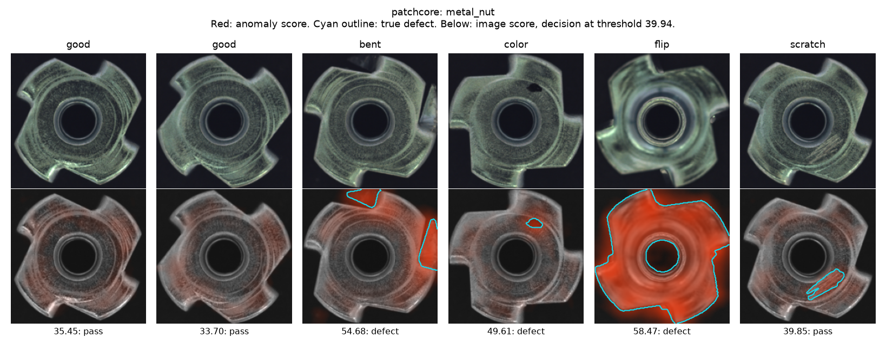

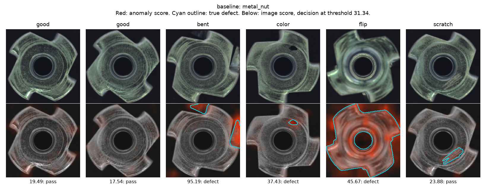

### screw

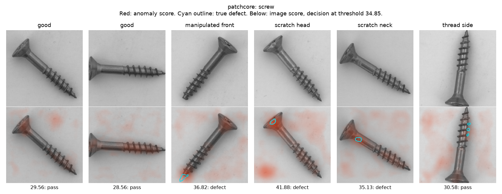

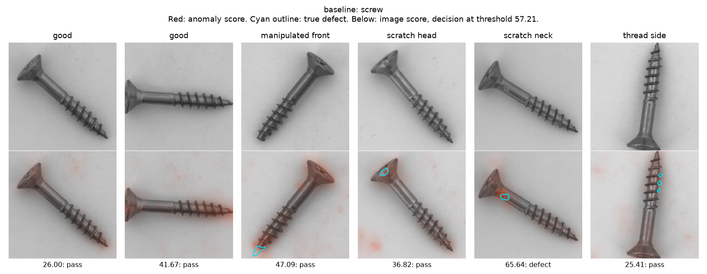

### pill

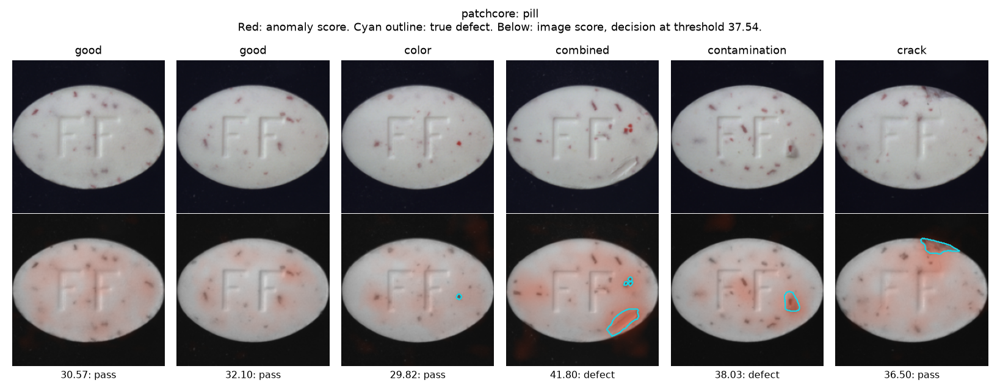

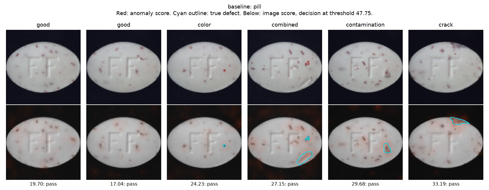

### transistor

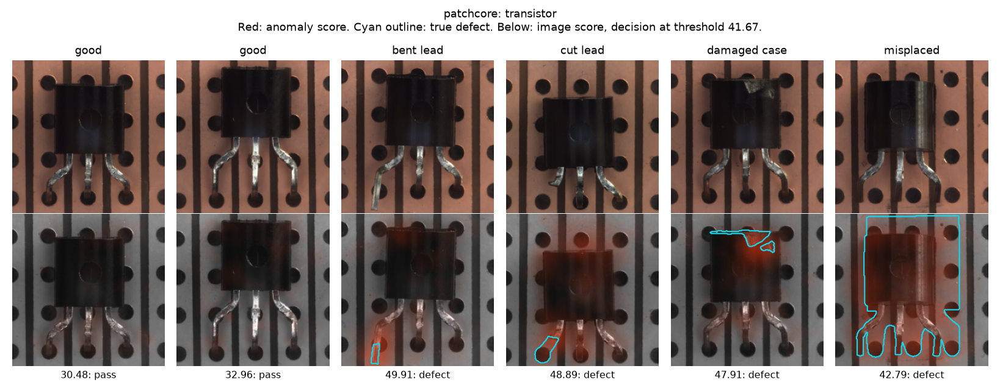

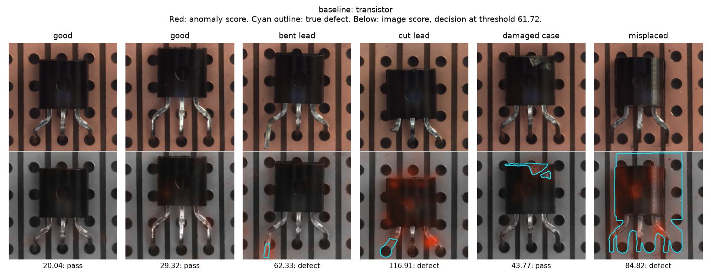

### bottle

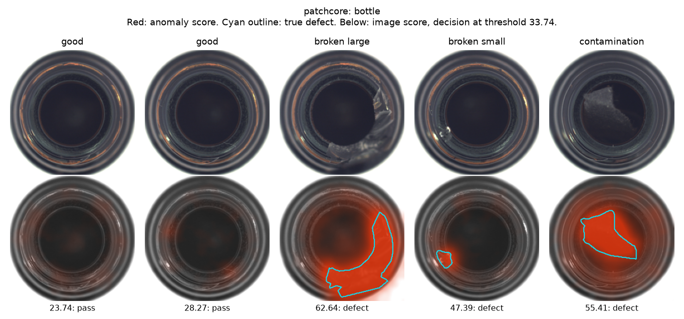

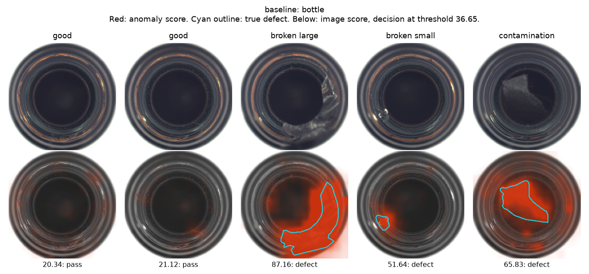

### carpet

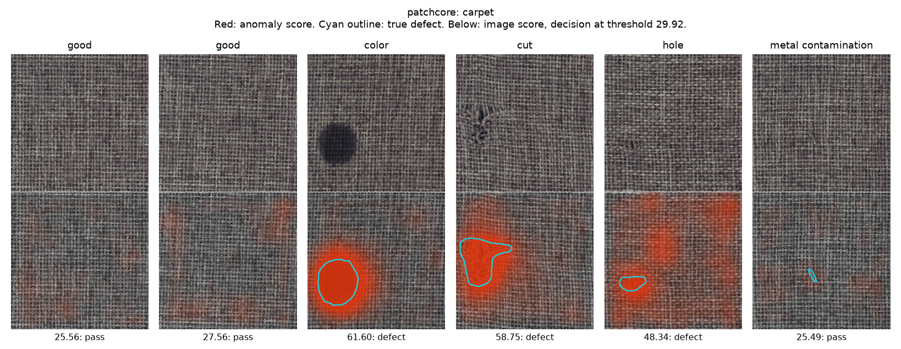

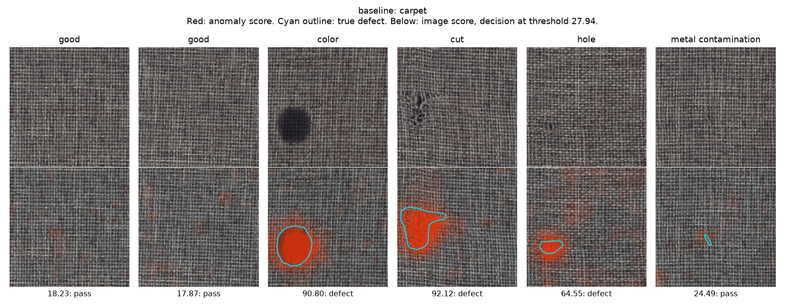
